# 用一个 Router 学会 TLM 架构探索：transaction 级建模与参数扫描

> 本文用同一个 NoC router 建两个模型：**LT 做「连通性和带宽够不够」的粗粒度探索，AT 做「延迟和拥塞怎么样」的细粒度探索**。两者共用一份真实 router spec、同一套拓扑与路由参数、同一条服务时间公式，差别只在流控协议与时间模型。

---

## 0. 先给结论

| | **LT router** | **AT router** |
| --- | --- | --- |
| 流控协议 | ready / valid 握手 | credit 流控 |
| 时间模型 | `b_transport` 累加每跳固定服务时间 | `nb_transport` 四相 + `sc_time&` 时间注解 + 链路排队 |
| 探索粒度 | **粗粒度：连通性和带宽够不够** | **细粒度：延迟和拥塞怎么样** |
| 能看见 | 目的可达、平均跳数、链路服务率、需求带宽 | 延迟-负载曲线、饱和吞吐、排队等待、最忙链路 |
| 看不见 | 排队、饱和点、拥塞 | VC 分配、arbiter 微架构、逐周期尾延迟 |

AT 没有逐周期流水线，但**竞争一点没丢**：所有拥塞都被上移到「输出链路 = 单服务器」，用 `link_free_at[op]` 一个时间戳数组和 `sc_time& delay` 时间注解兑现。

| 这一版能回答 | 这一版不能回答 |
| --- | --- |
| mesh / torus / ring 谁更适合目标 workload | VC 数量、分配策略的微架构收益 |
| XY / YX / oblivious 路由在均匀与对抗性流量下的差异 | arbiter 微架构与逐周期 HOL blocking |
| 注入率扫描 → 延迟-吞吐曲线与饱和点 | cycle 级尾延迟精度 |
| 消息长度、链路带宽、消息粒度的取舍 | 精确 power / area |
| 任务映射与链路利用率分布 | 协议级死锁的形式化证明 |

**实测三句话**：零负载延迟对齐解析式 22 ns（AT 24.11 ns / LT 23.00 ns）；AT 的延迟随负载从 24.11 涨到 72.29 ns 而 LT 恒为 23.00 ns；43 轮参数扫描主体在数秒内完成，这个速度才让「拓扑 × 路由 × 流量 × 注入率 × 消息长度」的组合搜索成为可能。

配套代码全部可编译、可运行，扫描结果可复现。全部文件（文章、源码、配图、43 轮扫描数据）都在公开仓库 [andyzhenghome/systemc-tlm-router-dse](https://github.com/andyzhenghome/systemc-tlm-router-dse)，§14 给出从 clone 开始的完整复现步骤。文章里所有数字都来自 `code/noc_txn_demo` 的真实输出。

---

## 1. TLM 建模的基本思路

在动手写 router 之前，先把 TLM 的世界观讲清楚。否则后面的代码看起来像一堆莫名其妙的 `delay` 加减法。

### 1.1 通信是「事务」，不是信号

TLM（Transaction Level Modeling）不描述 `valid` 信号在第几个时钟沿拉高，而是描述一次完整的通信：

> **谁，在什么时候，把什么东西，交给谁。**

这四个要素在 TLM-2.0 里一一对应：

| 要素 | TLM-2.0 载体 |
| --- | --- |
| 谁 / 交给谁 | initiator socket ↔ target socket |
| 什么东西 | `tlm_generic_payload`（command / address / data / extensions） |
| 什么时候 | `sc_time& delay` 时间注解 |
| 完成与否 | `tlm_sync_enum` / `tlm_response_status` / 四相 phase |

一个 payload 从头走到尾可以穿过多个模块，端到端复用同一个对象。`tlm_mm_interface` 管它的池化与引用计数，`tlm_extension` 往上面挂私有元数据——这些都是为了让「一次通信」成为一个可以携带状态的对象，而不是一串波形。

### 1.2 时间注解：AT 与 LT 的分水岭

TLM 里最容易误解的是 `sc_time& delay`：

```cpp
tlm::tlm_phase ph(tlm::BEGIN_REQ);
sc_core::sc_time d = sc_core::sc_time(5, sc_core::SC_NS);
sock->nb_transport_fw(*t, ph, d);     // d 既是输入也是输出
```

**它是一张随事务传递的时间支票，不是 `wait()`。** 上游把「这件事应该发生在 now + delay」写进去，下游在这个语义时刻继续处理；下游也可以往里追加自己的耗时，再把同一张支票传给下一跳。于是一条消息穿过 4 跳，绝对时间严格连续，却不需要 `sc_clock`、不需要 `SC_METHOD`、不需要任何一个进程被唤醒。

两种编码风格由此分叉：

| | **AT（Approximately Timed）** | **LT（Loosely Timed）** |
| --- | --- | --- |
| 主接口 | `nb_transport_fw / bw`，非阻塞 | `b_transport`，阻塞 |
| 相位 | 标准四相 + 扩展相位 + PEQ 时间事件 | 无相位 |
| 时间 | 注解里可以表达「排队到某时刻才开始」 | 只累加每跳固定服务时间 |
| 反压 | 可以（本文用 credit） | 没有 |
| 典型用途 | 性能 / 拥塞分析 | 软件开发、功能验证、早期 bring-up |

### 1.3 旁路机制

- **extension**：ignorable extension（`txn_ext`）随 payload 端到端走；instance-specific extension（`inj_ext`）只在某一条链路的一个端点可见。
- **memory manager**：payload 池 + `acquire()/release()`，避免每条消息 `new/delete`。
- **DMI / `transport_dbg`**：直访与无副作用快照，不推进仿真时间。
- **`tlm_analysis_port`**：把性能统计挂在事务通路之外，零时序影响。
- **`tlm_quantumkeeper`**：LT 的 temporal decoupling，本地时间先跑，攒够了再 `sync()`。

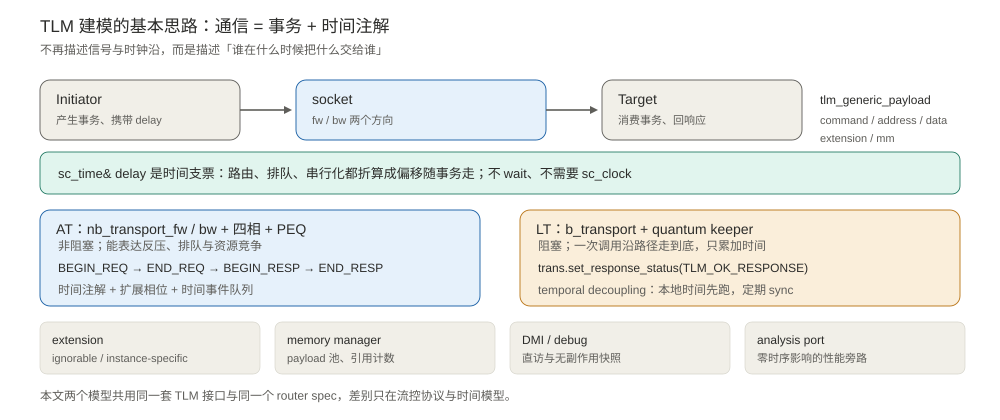

**一句话**：本文两个模型用的是同一套 TLM 接口、同一份 router spec、同一条服务时间公式。差别只有两件事——流控协议（credit vs ready/valid）和时间模型（有没有排队）。

---

## 2. Router 的基本原理

### 2.1 一个 router 里有什么

片上网络（NoC）把很多计算节点连起来，负责转发的就是 router。一个典型的虚通道输入排队 router 有 5 个方向端口 `N / E / S / W / L`（`L` 是本地网络接口 NI），每条输入通路大致包含：

- **输入缓冲 / VC**：先存下来，等待调度；
- **Routing Logic**：根据目的地址算出该走哪个输出端口；
- **VC Allocator / Switch Allocator**：决定谁拿到下游通道、谁本周期能用 crossbar；
- **Crossbar**：把某个输入端口接到某个输出端口；
- **输出链路与 credit 流控**：下游缓冲空出来之后，用 credit 通知上游「可以继续发」。

### 2.2 一条消息穿过一跳：RC → VA → SA → ST

BookSim2 的 `IQRouter` 把一跳拆成四级流水：

| 阶段 | 做什么 | 为什么需要 |
| --- | --- | --- |
| **RC** Route Computation | 解析目的坐标，确定输出端口 | 每跳都要重新选路 |
| **VA** VC Allocation | 申请下游的一条虚通道 | 多个输入可能争同一个下游资源 |
| **SA** Switch Allocation | 仲裁谁本周期使用 crossbar | 一个输出端口一次只能服务一条消息 |
| **ST** Switch Traversal | 穿过 crossbar 上链路 | 传输本身要占用链路时间 |

**SA 这一级就是「竞争」的物理来源**：输出端口是独占资源，后来的必须等。这也是本文模型唯一必须保留的约束。

### 2.3 credit 流控为什么存在

如果上游不管下游有没有地方存，一味地发，缓冲就会溢出。credit-based flow control 的做法是：

1. 上游持有若干 credit，每个代表下游一个空闲缓冲槽；
2. 发一条消息消耗一个 credit；
3. 下游把消息消费掉、腾出槽位后，沿反向通路归还一个 credit；
4. credit 用尽，上游必须停。

它同时带来一个有用的副作用：**credit 迟迟不还，就说明下游堵了**。所以 credit 既是流控，也是拥塞的观测窗口。本文的 AT 模型正是靠这一点做反压。

### 2.4 NoC = router + 链路

换拓扑只改「每个输出端口连到哪个邻居」，router 本身不用动；换路由算法只改 `route_port()`，连线不用动；换流量模式只改 `pick_dst()`，代码一行都不用动。这就是「只建一个统一 router 模型」的含义。

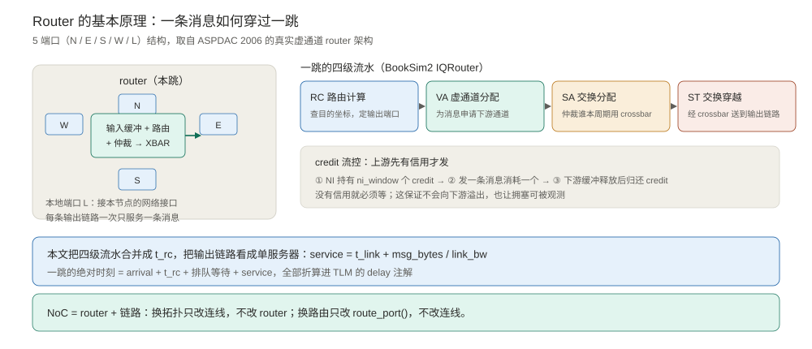

### 2.5 真实 spec：拿一张论文里的架构图，别自己画

降低抽象层级不等于可以拍脑袋画方块。你仍然需要一份真实 spec 来确定**端口数、缓冲在哪、路由函数怎么走、哪条链路算一跳**——否则参数扫描扫的是自己想象出来的机器。

本文用 Mullins / West / Moore 在 ASPDAC 2006 论文中的 Fig. 1：

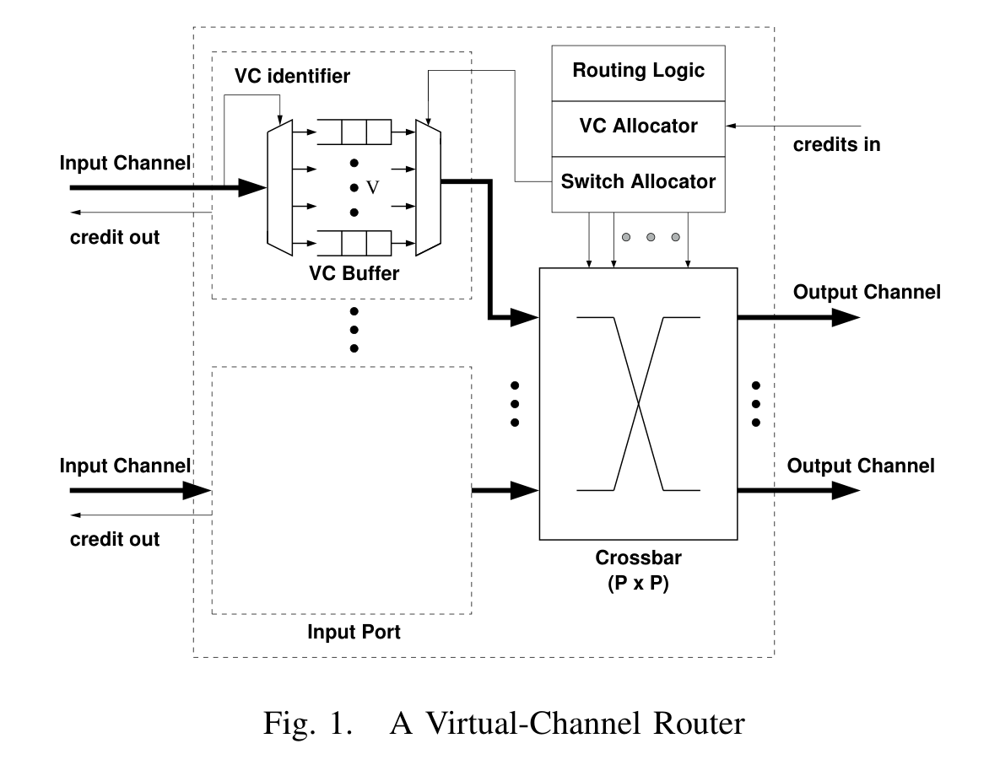

| 真实 spec 部件 | 本模型怎么处理 | 理由 |
| --- | --- | --- |
| Input / Output Channel | 5 端口 `N/E/S/W/L`，每端口一个链路 server | 架构探索必须知道 radix 和方向 |
| VC identifier | 抽象掉，路由结果直接是输出端口 | VC 数相关的结论不在本层回答 |
| VC Buffer (FIFO) | 输入队列深度只统计、不设硬上限 | 排队网络常见假设，饱和由服务率决定 |
| Routing Logic | `route_port()`，支持 XY / YX / oblivious | 本层的核心设计旋钮 |
| VC Allocator | 抽象掉 | 需要周期级模型或 RTL 才能评估 |
| Switch Allocator | 抽象成「一个输出端口同时只服务一条消息」 | 这正是链路单服务器约束 |
| Crossbar (P×P) | 隐含在 `link_free_at[op]` 里 | 端口级独占即 crossbar 的带宽约束 |
| credits in / out | AT 用 `ni_window` + `BEGIN_RESP`；LT 用 ready/valid | 两套协议对应两种探索粒度 |

流水线参数体系沿用 BookSim2 `IQRouter` 的 `RC → VA → SA → ST` 与 `routing_delay / vc_alloc_delay / sw_alloc_delay / st_final_delay / credit_delay`。本层把它们合并成一个 `t_rc`，加上 `t_link + msg_bytes / link_bw` 构成服务时间。

---

## 3. 两套流控协议，两种探索粒度

这是本文最核心的设计决定。

### 3.1 为什么协议决定能看见什么

| | **LT router** | **AT router** |
| --- | --- | --- |
| 协议 | ready / valid 握手 | credit-based flow control |
| 下游何时可接收 | 永远 `ready=1` | 要有 credit |
| 没有资源时 | 不存在这种情况 | 上游停发，消息在链路 server 前排队 |
| 时间模型 | 每跳固定 `t_rc + t_service` 累加 | `start = max(arrival+t_rc, link_free_at[op])` |
| 结果 | 延迟与注入率无关 | 延迟随负载上升，吞吐封顶 |
| **适合回答** | **连通性和带宽够不够**（粗粒度探索） | **延迟和拥塞怎么样**（细粒度探索） |

粗粒度问题长这样：「这个拓扑能不能把 A 送到 B？平均几跳？给 16 B/ns 的链路，64 B 的消息会不会把带宽吃光？」——它们只需要路径长度和服务时间，不需要知道谁排在谁前面。

细粒度问题长这样：「注入率翻倍之后延迟涨多少？哪条链路先饱和？还有多少余量？换路由能不能把热点摊开？」——它们必须建模排队，而排队的前提是「资源被占用时后来的要等」，也就是 credit 反压。

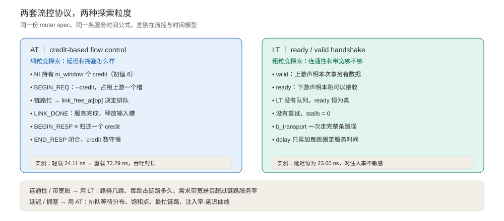

### 3.2 AT 的 credit 生命周期

```
NI 持有 ni_window 个 credit
   │
   ├─ BEGIN_REQ（注入一条消息）        credit--，占用下游一个队列槽
   │
   ├─ 链路服务完成 LINK_DONE          释放输入槽
   │
   ├─ BEGIN_RESP ≡ 归还一个 credit   经四相反向路径送回上游
   │
   └─ END_RESP                       上游确认，本跳闭合
```

`BEGIN_RESP` 在这里不只是「响应」，它**就是一个 credit**。四相握手因此变成了流控协议的一部分，而不是额外的礼仪。

### 3.3 LT 的 ready / valid 时序

```
上游：valid = 1（本次事务有数据）
下游：ready = 1（本跳可以接收）      ← LT 没有队列，恒为真
握手成立 → b_transport 沿路径走完 → delay += t_rc + t_service
```

没有信用、没有重试、没有 `stalls`。一次 `b_transport` 调用就把消息从源送到汇，非常适合快速验证「路通不通、账算不算得过来」。

**LT 不是错的模型，只是不回答拥塞问题。** 拿它做容量规划才是误用。

---

## 4. 架构探索要回答什么，以及抽象层级决策

### 4.1 五个典型问题

1. 16 个节点，用 4×4 mesh、4×4 torus 还是 16 节点 ring？
2. 路由用确定性 XY，还是逐包随机的 oblivious？对目标流量哪个稳？
3. 链路给 8 / 16 / 32 B/ns 够不够？消息切多大合适？
4. 系统在哪个注入率开始饱和？留多少余量？
5. 通信密集的任务该放在哪几个节点上？

共同点是：**要的是「趋势」和「拐点」，不是某一个 cycle 上谁先谁后**。

```
模型价值 = 能区分的设计方案数 × 每个结论的可信度 ÷ 单次仿真耗时
```

把 router 做成 cycle-accurate 会把前两项拉满，却把第三项拖垮。于是有了不同层级的取舍：

| | **LT（本文）** | **AT（本文）** | 周期级模型 / RTL |
| --- | --- | --- | --- |
| 事务粒度 | 1 条消息 = 1 payload | 1 条消息 = 1 payload | 逐周期信号 |
| 流控 | ready / valid | credit | 完整缓冲与仲裁 |
| 竞争建模 | 无 | 输出链路单服务器 + 排队 | 逐周期资源争用 |
| 能看见饱和点 | 不能 | **能** | 能 |
| 需要 `sc_clock` | 否 | **否** | 是 |
| 典型用途 | 连通性、带宽账、功能验证 | 架构探索、参数扫描 | 微架构选型、签核 |

### 4.2 一条消息 = 一个事务

对架构探索而言，一条消息占用链路的时间只取决于**它有多长**和**链路有多快**：

```
t_serialize = msg_bytes / link_bw
```

这是一个标量。把它算出来加进 `delay`，和把消息切成多个片再逐个累加，在「这一跳什么时候结束」这个问题上等价。省下的是 4 倍事务数、大量扩展相位、每周期唤醒的仲裁进程。

### 4.3 丢的是实现细节，不是竞争

最容易踩的坑：如果「只用 transaction」被实现成「每跳固定延迟累加一遍」，模型就退化成 LT 了。看实测：

| 模型 | gap=64（轻载） | gap=1（重载） | 结论 |
| --- | --- | --- | --- |
| LT（ready/valid） | 23.00 ns | 23.00 ns | 对注入率完全不敏感 |
| AT（credit + 竞争） | 24.11 ns | 72.29 ns | 延迟翻近 3 倍，能看到拐点 |

LT 会把饱和点画成一条不存在的直线。**所以真正要保留的不是逐周期细节，而是「资源有限、后来的要排队」这件事。**

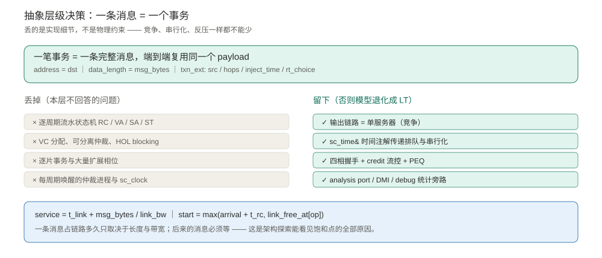

---

## 5. 链路单服务器服务模型与校准

### 5.1 四行算术

把竞争上移到输出端口，只需一个时间戳数组：

```
arrival = now + delay                              // 时间注解给出的到达时刻
start   = max(arrival + t_rc, link_free_at[op])    // 端口忙就排队
service = t_link + msg_bytes / link_bw             // 串行化时间
link_free_at[op] = start + service
delay   = start + service - now                   // 下游在 now+delay 看到它
```

`start - arrival - t_rc` 就是排队等待。整条链路服务率 `1 / service` 决定饱和吞吐。

**关键点：`delay` 不是 `wait()`。** 路由计算、排队、串行化全部折算成一个时间偏移交给下游，下游在 `now+delay` 的语义上继续处理。没有 `sc_clock`、没有 `SC_METHOD(arbitrate)`，进程调度开销几乎为零。

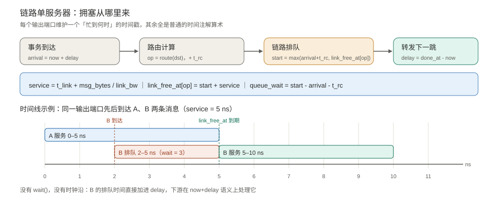

### 5.2 拿到数据之前先算一遍

架构探索模型必须校准，否则扫描出来的比较结论没有可信度。两个解析锚点：

| 锚点 | 解析式 | 代入本文默认配置 | 实测 |
| --- | --- | --- | --- |
| 零负载延迟 | `avg_hops × (t_rc + t_link + msg_bytes/link_bw)` | `3.6667 × (1 + 1 + 4) = 22.0 ns` | AT 24.11 / LT 23.00 ns |
| 单链路服务率 | `1 / (t_link + msg_bytes/link_bw)` | `1 / 5 ns = 200 msgs/us` | 全系统饱和于 ≈2400 msgs/us |

差出的 1–2 ns 来自注入时刻按 `gap` 离散化对齐，以及 `t_credit` 的反向路径开销，量级合理。若锚点对不上，先查服务时间公式和 `hops` 统计，不要急着扫参数。

---

## 6. TLM-2.0 特性全景

| TLM-2.0 特性 | AT 模型用在哪 | LT 模型用在哪 |
| --- | --- | --- |
| `tlm_generic_payload` | 一条消息一个 payload，端到端复用 | 同左 |
| 自定义 `protocol types` | 脱离 base protocol 单事务限制 | 共用同一套定义 |
| 标准四相 `BEGIN_REQ/END_REQ/BEGIN_RESP/END_RESP` | 主通路，`BEGIN_RESP ≡ credit` | 不用 |
| 扩展相位 `LINK_DONE` / `CREDIT` | 链路完成时刻与 credit 归还事件 | 不用 |
| `nb_transport_fw / bw` | 前向 / 反向主通路 | 不用 |
| `b_transport` | 混合调用兜底 | **主通路** |
| `sc_time&` 时间注解 | 承载排队 + 串行化时间 | 只累加固定服务时间 |
| `peq_with_cb_and_phase` | 驱动反向路径时间事件 | 不用 |
| ready / valid（`rv_ext`） | 不参与时序 | **每跳握手** |
| credit（`ni_window` + `BEGIN_RESP`） | **NI 硬反压** | 无 |
| `tlm_quantumkeeper` / global quantum | 不用 | temporal decoupling |
| ignorable extension | `txn_ext`（消息元数据） | `txn_ext` + `rv_ext` |
| instance-specific extension | `inj_ext`（NI 私有上下文） | 不用 |
| memory manager + `acquire/release` | payload 池与引用计数 | 同左 |
| `multi_passthrough_target_socket` | 接所有上游链路 | 同左 |
| `simple_initiator_socket_tagged` | tag = 输出端口 | 同左 |
| `tlm_analysis_port` / `tlm_analysis_if` | 零副作用性能旁路 | 同左 |
| `transport_dbg` | 读输入队列深度快照 | 读握手计数 |
| DMI | router 正确拒绝，sink 授予 | 同左 |
| `TLM_COMPLETED` 早完成 | 终点 sink 短路四相 | 不适用 |
| 巡礼：`cancel_all()`、`deep_copy_from`、多 passthrough initiator、大小端、DMI、analysis | `code/tlm_feature_tour.cpp` | 同左 |

**教学价值一点没少，只是重心从「扩展相位驱动流水线」移到了「时间注解 + 服务模型 + 两套流控协议」。**

---

## 7. 事务与数据结构

`code/noc_txn_common.h` 定义公共类型。几处值得注意的设计：

```cpp
// 自定义 protocol types：NoC 链路上同时有多条 in-flight 消息，
// 必须显式脱离 base protocol「每 socket 一个未完成事务」的规则
struct noc_protocol_types {
  typedef tlm::tlm_generic_payload tlm_payload_type;
  typedef tlm::tlm_phase           tlm_phase_type;
};

// 扩展相位只有两个，都服务于 AT 的 credit 流控
TLM_DECLARE_EXTENDED_PHASE(LINK_DONE);   // 链路服务完成
TLM_DECLARE_EXTENDED_PHASE(CREDIT);      // 归还事件的时间注解
```

```cpp
// LT 的 ready/valid 握手：一次事务 = 一次握手
struct rv_ext : tlm::tlm_extension<rv_ext> {
  bool valid = false;                 // 上游：本次事务有数据要发
  bool ready = false;                 // 下游：本跳可以接收
  unsigned int stalls = 0;            // 因 ready=0 重试的次数（LT 恒 0）
  sc_core::sc_time handshake_at = sc_core::SC_ZERO_TIME;
};
```

```cpp
struct txn_ext : tlm::tlm_extension<txn_ext> {
  int msg_id = 0, src = 0, dst = 0, hops = 0;
  int msg_bytes = 64;          // 服务需求，不做逐片切分
  int rt_choice = 0;           // oblivious 路由的逐包选择
  sc_core::sc_time inject_time = sc_core::SC_ZERO_TIME;
  int in_port = P_L;           // 逐跳字段，进入下一跳前由上游重写
  int out_port = -1;
};
```

**逐跳状态不放在 extension 里。** 同一个 payload 端到端复用，router 每跳都会重写 `in_port`；等反向 `BEGIN_RESP` 回来时，注入时写进去的值早就不在了。所以每个 router 用自己的 `HopCtx` 表按 payload 指针保存本跳上下文：

```cpp
struct HopCtx {
  int port = -1, bind = -1, out_port = -1;
  sc_core::sc_time arrival, done_at;
  double wait_ns = 0.0;
};
std::map<gp_t*, noc::HopCtx> rx_ctx, tx_ctx;   // 每个 router 各一份
```

配置参数全部是可扫描的 design knob：

```cpp
struct RouterConfig {
  int mesh_x = 4, mesh_y = 4;
  Topology topology = TOPO_MESH;   // mesh / torus / ring
  Routing  routing  = RT_XY;       // xy / yx / oblivious
  Traffic  traffic  = TR_UNIFORM;  // uniform / transpose / bitcomp / hotspot
  int ni_window = 8;               // AT 的 credit 池：NI 允许同时 in-flight 的消息数
  int n_messages = 30, msg_bytes = 64;
  double link_bw = 16.0;           // bytes / ns
  int rc_cycles = 1, credit_cycles = 1, link_cycles = 1;
  int inject_gap_cycles = 8;

  sc_core::sc_time t_service(int bytes) const {
    return t_link() + sc_core::sc_time((double)bytes / link_bw, sc_core::SC_NS);
  }
};
```

> 配置里**没有** VC 数、缓冲深度、VA / SA 周期数。这些是微架构旋钮，需要它们请上周期级模型或 RTL。把不该在本层出现的旋钮留在配置里，只会让人误以为模型能回答它答不了的问题。

---

## 8. AT router：credit 流控的逐段实现

`code/router_txn.h` 是核心。整个模型只有一个状态数组、一个 PEQ 和一组 credit 计数。

### 8.1 状态

```cpp
std::vector<sc_core::sc_time> link_free_at;  // 每个输出端口「忙到何时」
std::vector<sc_core::sc_time> busy_time;    // 累计服务时间 -> 利用率
std::vector<sc_core::sc_time> busy_begin;   // 第一次开始服务的时刻
std::vector<int>              occupancy;    // 输入队列深度统计
unsigned long n_credit_issued = 0, n_credit_returned = 0;
std::map<gp_t*, noc::HopCtx>  rx_ctx, tx_ctx;
tlm_utils::peq_with_cb_and_phase<RouterTxn, PT> peq;
```

没有 `VC` 结构、没有 `deque<gp*>` FIFO、没有 `SC_METHOD(arbitrate)`、没有 `sc_in<bool> clk`。`link_free_at[op]` 一个数组就代替了整个 crossbar + arbiter 的带宽约束：**同一输出端口，一次只服务一条消息**。

### 8.2 前向路径：服务时间 + 时间注解

```cpp
tlm::tlm_sync_enum nb_fw(int bind, gp_t& trans, ph_t& phase,
                         sc_core::sc_time& delay)
{
  if (phase == tlm::BEGIN_REQ) {
    noc::txn_ext* ex = trans.get_extension<noc::txn_ext>();
    const sc_core::sc_time now     = sc_core::sc_time_stamp();
    const sc_core::sc_time arrival = now + delay;

    int dx, dy; noc::id2xy(ex->dst, cfg.mesh_x, dx, dy);
    const int op = noc::route_port(cfg.topology, cfg.routing,
                                   cfg.x, cfg.y, dx, dy,
                                   cfg.mesh_x, cfg.mesh_y, ex->rt_choice);

    // ---- 竞争全在这里 ----
    const sc_core::sc_time earliest = arrival + cfg.t_rc();
    const sc_core::sc_time start   = std::max(earliest, link_free_at[op]);
    const sc_core::sc_time service = cfg.t_service(ex->msg_bytes);
    const sc_core::sc_time done_at = start + service;
    link_free_at[op] = done_at;
    busy_time[op]   += service;

    const double qwait = (start - earliest).to_seconds() * 1e9;

    ++occupancy[ip];          // 占用上游的一个 credit
    ++n_credit_issued;
    trans.acquire();
    rx_ctx[&trans] = HopCtx{ip, bind, op, arrival, done_at, qwait};

    peq.notify(trans, ph_t(tlm::END_REQ), delay);          // 请求已接受
    peq.notify(trans, noc::LINK_DONE, done_at - now);      // 链路服务完成

    // ---- 立刻转发，整跳耗时累加进 delay ----
    delay = done_at - now;
    ++ex->hops;
    ex->in_port = noc::opposite(op);
    trans.acquire();
    tx_ctx[&trans] = HopCtx{op, op, op, arrival, done_at, qwait};
    ph_t p_begin_req(tlm::BEGIN_REQ);
    auto s = (*out[op])->nb_transport_fw(trans, p_begin_req, delay);
    if (s == tlm::TLM_COMPLETED) { tx_ctx.erase(&trans); trans.release(); }
    return tlm::TLM_ACCEPTED;
  }
  if (phase == tlm::END_RESP) {
    rx_ctx.erase(&trans); trans.release();                 // 四相闭合
    return tlm::TLM_COMPLETED;
  }
  return tlm::TLM_ACCEPTED;
}
```

注意 `delay = done_at - now` 这一行：**排队时间没有让任何进程 `wait()`，它只是被加进了随事务传递的时间注解**。

### 8.3 credit 怎么归还

```cpp
void peq_cb(gp_t& trans, const ph_t& phase)
{
  if (phase == noc::LINK_DONE) {
    auto it = rx_ctx.find(&trans);
    const int bind = it->second.bind;      // 先取值！下面会重入
    const int port = it->second.port;

    --occupancy[port];                     // 释放输入 message slot
    ++n_credit_returned;                  // 归还一个 credit
    ph_t p(tlm::BEGIN_RESP);              // BEGIN_RESP ≡ 一个 credit
    sc_core::sc_time d = cfg.t_credit();
    in[bind]->nb_transport_bw(trans, p, d);   // 沿四相反向送回上游
  }
  // ... END_REQ / CREDIT 分支略
}
```

上游收到 `BEGIN_RESP` 后 `++inj_credit` 并回 `END_RESP`，本跳的 `rx_ctx` 条目随之释放。四个相位与信用池的完整对应：

| 路径 | 机制 | 内容 |
| --- | --- | --- |
| 前向 | 同步 `nb_transport_fw` + `delay` 注解 | 立即推进到下一跳 |
| 反向 `END_REQ` | PEQ 在 `arrival` 时刻 | 「请求已接受」 |
| 反向 `BEGIN_RESP` | PEQ 在 `done_at + t_credit` | **归还一个 credit**，输入槽释放 |
| 扩展 `CREDIT` | 尊重 bw 路径的 `delay` 注解 | 释放 initiator 侧引用 |
| 闭合 `END_RESP` | 上游经 fw 路径发回 | `rx_ctx.erase` + `release()` |

**这里踩过一个真实的坑**（见踩坑清单）：PEQ 回调里调用 `nb_transport_bw` 会同步触发上游的 `END_RESP`，进而重入当前 router 的 `nb_fw(END_RESP)` 把 `rx_ctx` 条目删掉。必须先取值再调用，否则迭代器立刻悬空。

### 8.4 反压与统计

NI 侧维护 `inj_credit`（初值 `ni_window`），没有空槽就 `wait(cfg.clk)`；`BEGIN_RESP` 回来时归还。用 `inj_ext : instance_specific_extension` 记住注入端私有上下文，避免逐跳字段污染。

中间 router 的缓冲采用排队网络里常见的**无硬上限**假设，输入队列深度只作观测量统计。饱和点由链路服务率而不是缓冲耗尽决定——这是 transaction 级的关键近似，也是它偏乐观的地方。

性能统计走 `tlm_analysis_port<TxnRecord>` 旁路，`PerfMonitor : tlm_analysis_if` 收集延迟分布、跳数、排队等待，完全不占事务通路、不影响时序。链路利用率的分母要用「该端口第一次服务开始到最后一次服务结束」，否则排队延伸到窗口外时会算出大于 1 的假值。

### 8.5 DMI 与 debug

router 是有状态互连而不是 memory，`get_direct_mem_ptr()` 的正确做法是**拒绝**（`set_dmi_allowed(false); return false`）。`transport_dbg()` 只返回输入队列深度快照，不推进时间、不修改状态。终点 `NetworkSink` 的统计寄存器则正常授予 DMI。

### 8.6 实测输出

```
[AT] max link utilization = 0.7273, peak input queue depth = 6 msgs (NI credit window = 8)
[AT] credit: issued = 1760, returned = 1760, in flight at end = 0
```

credit 严格守恒：发出多少，就归还多少，仿真结束时没有悬空事务。

---

## 9. LT router：ready / valid 的逐段实现

`code/router_txn_lt.h` 与 AT 版**完全相同**的 spec、拓扑、路由、消息长度、链路带宽，唯一区别是流控协议与时间模型。

### 9.1 每跳握手

```cpp
void b_fw(int, gp_t& trans, sc_core::sc_time& delay)
{
  noc::txn_ext* ex = trans.get_extension<noc::txn_ext>();
  noc::rv_ext*  rv = trans.get_extension<noc::rv_ext>();

  // ready/valid：valid 才是一次有效传输；LT 没有队列，永远 ready
  if (rv) {
    if (!rv->valid) {
      trans.set_response_status(tlm::TLM_GENERIC_ERROR_RESPONSE);
      return;
    }
    rv->ready = true;                       // 本跳接收
    ++n_handshake;
  }

  const int op = /* 同样的 route_port(...) */;
  const sc_core::sc_time service =
      cfg.t_rc() + cfg.t_service(ex ? ex->msg_bytes : cfg.msg_bytes);
  delay += service;                         // LT 的全部时序
  if (rv) rv->handshake_at = sc_core::sc_time_stamp() + delay;

  ++ex->hops;
  ex->in_port = noc::opposite(op);
  bytes_offered += ex->msg_bytes;
  trans.set_response_status(tlm::TLM_OK_RESPONSE);
  (*out[op])->b_transport(trans, delay);   // 一次调用链走到底
}
```

`valid` 由注入端在 `make_txn()` 里置位，`ready` 由每一跳（包括终点 `NetworkSink`）置位。因为 LT 没有队列、没有信用、没有 `link_free_at`，`ready` 永远为真，`stalls` 恒为 0。

### 9.2 注入端与 temporal decoupling

```cpp
t->acquire();
sc_core::sc_time d = qk.get_local_time();
sock->b_transport(*t, d);
// b_transport 返回即整条路径走完；读 ready 必须在 release() 之前
noc::rv_ext* rv = t->get_extension<noc::rv_ext>();
if (rv->valid) ++n_valid;
if (rv->ready) ++n_ready; else ++n_stall;
t->release();
```

注意 `inject_time` 必须写成 `sc_time_stamp() + qk.get_local_time()`，否则 temporal decoupling 下延迟统计会虚高。

### 9.3 实测输出

```
[LT] ready/valid: valid = 480, ready = 480, stalls = 0, router handshakes = 1760
[LT] bandwidth check: t_serialize = 4.0000 ns, t_service = 5.0000 ns,
     link service rate = 0.2000 msgs/ns, per-node injection = 0.1250 msgs/ns
```

480 条消息、1760 次逐跳握手，全部一次成功。这就是 LT 能干净回答「路通不通」的证据。

### 9.4 带宽账怎么算

`ready/valid` 本身不提供容量信息，但 `t_service` 提供：

```
单链路服务率 = 1 / (t_link + msg_bytes / link_bw) = 1 / 5 ns = 0.2 msgs/ns
每节点注入率 = 1 / gap                            = 1 / 8   = 0.125 msgs/ns
```

把注入率按平均跳数摊到各条链路上，再和 `0.2 msgs/ns` 比较，就是一阶的带宽够不够判断。改 `msg_bytes` 或 `link_bw` 只需重算这个比值——§11.4 会验证模型确实只认这一个比值。

**LT 的边界也在这里**：它能告诉你「按平均值算带宽够」，但不会告诉你瞬时突发造成的排队。要那个，必须切到 AT。

---

## 10. 从 router 到 NoC：三条正交的轴

统一 router 模型与拓扑解耦的关键，是把三件事拆成三个独立参数：

| 轴 | 取值 | 由谁决定 |
| --- | --- | --- |
| 拓扑 | mesh / torus / ring | `bind_router()` 决定每个输出端口连到谁 |
| 路由 | XY / YX / oblivious | `route_port()` 决定本跳走哪个输出端口 |
| 流量 | uniform / transpose / bitcomp / hotspot | `pick_dst()` 决定消息发往哪个节点 |

```cpp
template <typename R>
static void bind_router(R* r, int id, int p, const std::vector<R*>& all,
                        NetworkSink* sink, NullSink* null_sink,
                        const noc::RouterConfig& cfg)
{
  if (p == noc::P_L) { r->out[p]->bind(sink->sock); return; }
  const int x = id % cfg.mesh_x, y = id / cfg.mesh_x;
  const int nid = noc::neighbor(cfg.topology, x, y, p,
                                cfg.mesh_x, cfg.mesh_y);
  if (nid >= 0) r->out[p]->bind(all[nid]->in);   // torus/ring 在这里环绕
  else          r->out[p]->bind(null_sink->in);
}
```

`RouterTxn` / `RouterTxnLT` 共享同一个 `bind_router` 模板——这就是「只建一个统一 router 模型」的含义：**换拓扑不用改 router，换路由不用改连线，换流量不用改任何代码，换协议不用改拓扑**。

命令行把三条轴全部暴露出来，扫描脚本直接拼参数：

```bash
./noc_txn_demo <at|lt> <mx> <my> <msgs/node> <gap_cycles> \
               <xy|yx|oblivious> <mesh|torus|ring> \
               <uniform|transpose|bitcomp|hotspot> <msg_bytes> <link_bw_B/ns>
```

每行输出末尾带一条机器可解析的 `CSV:`，`tools/sweep.py` 汇总成 `data/dse_results.csv`。

---

## 11. 架构探索实验：43 轮参数扫描

所有实验：16 个节点、每节点 30 条消息（共 480 条）、1 ns 时钟，除特别说明外 `msg_bytes=64`、`link_bw=16 B/ns`、XY 路由、uniform 流量。

### 11.1 实验一：注入率扫描，找饱和点

| gap (cycles) | AT 平均延迟 | AT 吞吐 (msgs/us) | 最忙链路利用率 | LT 平均延迟 |
| --- | --- | --- | --- | --- |
| 64 | 24.11 ns | 258.62 | 0.093 | 23.00 ns |
| 32 | 24.14 ns | 513.92 | 0.185 | 23.00 ns |
| 16 | 25.72 ns | 985.63 | 0.371 | 23.00 ns |
| 12 | 28.17 ns | 1315.07 | 0.495 | 23.00 ns |
| 8 | 33.67 ns | 1927.71 | 0.727 | 23.00 ns |
| 6 | 40.39 ns | 2318.84 | 0.925 | 23.00 ns |
| 4 | 60.98 ns | 2400.00 | 1.000 | 23.00 ns |
| 2 | 71.46 ns | 2400.00 | 1.000 | 23.00 ns |
| 1 | 72.29 ns | 2461.54 | 1.000 | 23.00 ns |

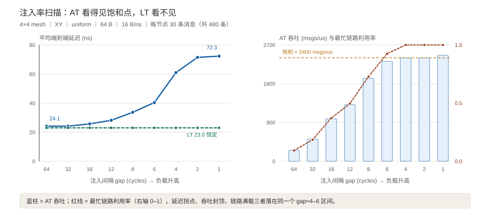

三个独立指标指向同一个拐点：**延迟在 gap≈6 开始翘起、吞吐在 ≈2400 msgs/us 封顶、最忙链路在 gap≈4 打满**。这就是容量规划要的「余量在哪」。

LT 一列从头到尾 23.00 ns。它并不是跑错了，只是 ready/valid 握手没有排队这个概念。

### 11.2 实验二：拓扑

同为 16 节点、XY 路由、uniform 流量：

| 拓扑 | 平均跳数 | gap=8 延迟 | gap=4 延迟 | gap=4 吞吐 |
| --- | --- | --- | --- | --- |
| 4×4 mesh | 3.6667 | 33.67 ns | 60.98 ns | 2400 msgs/us |
| 4×4 torus | **3.1333** | 23.64 ns | **45.53** ns | 2775 msgs/us |
| 16 节点 ring | 5.2667 | 313.20 ns | 349.53 ns | 332 msgs/us |

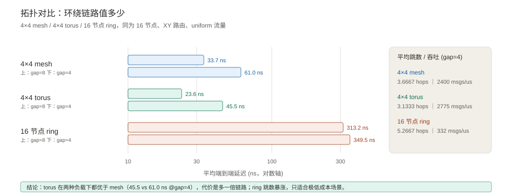

torus 的环绕链路把平均跳数从 3.67 降到 3.13，两种负载下都优于 mesh；代价是多一倍长链路。ring 平均跳数 5.27，吞吐只有 mesh 的 1/7，且几乎不随注入率变化——它被路径长度而非注入率卡死。

**架构决策**：如果布线预算允许长连线，torus 在这组 workload 下是明确更优的选择；ring 只在极端成本敏感场景才成立。

### 11.3 实验三：路由 × 流量

4×4 mesh、gap=4，平均端到端延迟（ns）：

| 流量 | XY | YX | Oblivious |
| --- | --- | --- | --- |
| uniform | **60.98** | 61.14 | 172.19 |
| transpose | 86.99 | 86.90 | **62.97** |
| bitcomp | 95.64 | 96.04 | **62.28** |
| hotspot | **135.44** | 138.24 | 215.27 |

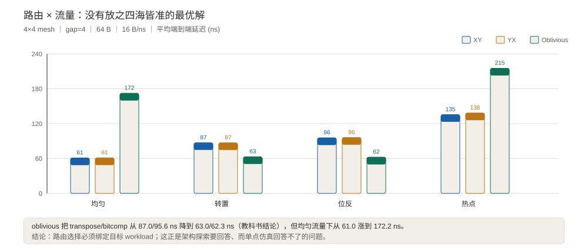

逐包随机选 XY/YX 的 oblivious 路由，把 transpose / bitcomp 这类对抗性置换流量从 87.0 / 95.6 ns 降到 63.0 ns——这是路由算法教科书里的经典结论，模型复现出来了。

但同一张表也给出反面：**oblivious 在均匀流量下从 61.0 涨到 172.2 ns，在热点流量下从 135.4 涨到 215.3 ns**。它打散了确定性 XY 在这组合成流量里天然形成的链路均衡，反而制造了新的争用。

> 诚实说明：这个方向性结论依赖具体的流量序列和 `rt_choice` 生成方式，不能当成「oblivious 必然伤害均匀流量」的普遍规律。它恰恰说明**路由选型必须绑定目标 workload，靠单点仿真下结论是危险的**——这正是架构探索存在的意义。

### 11.4 实验四：消息长度与链路带宽

| 消息长度（bw=16） | 平均延迟 | 吞吐 | 链路带宽（msg=64 B） | 平均延迟 | 吞吐 |
| --- | --- | --- | --- | --- | --- |
| 32 B | 25.41 ns | 3780 msgs/us | 8 B/ns | 123.61 ns | 1383 msgs/us |
| 64 B | 60.98 ns | 2400 msgs/us | 16 B/ns | 60.98 ns | 2400 msgs/us |
| 128 B | 123.61 ns | 1383 msgs/us | 32 B/ns | 25.41 ns | 3780 msgs/us |
| 256 B | 234.97 ns | 719 msgs/us | — | — | — |

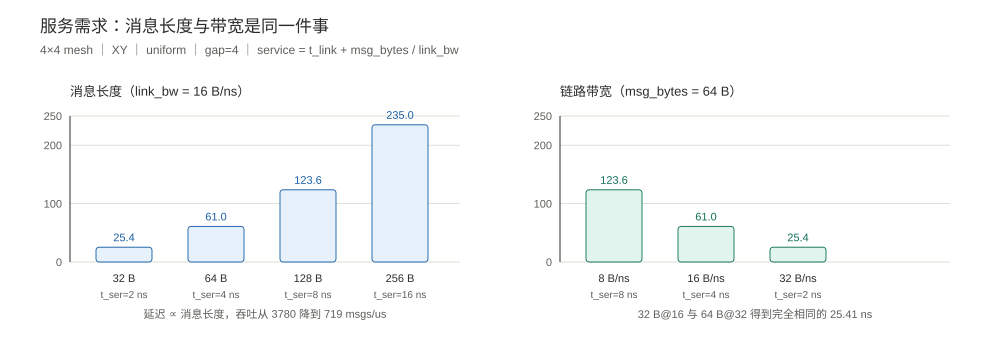

**32 B @ 16 B/ns 与 64 B @ 32 B/ns 得到完全相同的 25.41 ns**——因为两者的 `t_serialize = 2 ns` 一样。这不是巧合，是服务模型的自洽性检查：模型确实只通过 `msg_bytes / link_bw` 这一个比值感知这两个参数，也正是 LT 算带宽账的依据。

**架构决策**：给定链路带宽预算，把大消息拆小、或提高链路带宽，效果在服务时间上等价；真正的取舍在包头开销、缓冲面积和实现复杂度，那些不在本层模型的能力范围内。

### 11.5 LT 的用武之地：先算连通性和带宽账

把 §9.4 的解析式和 §11.1 的 LT 列放在一起，粗粒度探索的完整答案就出来了：

| 检查项 | LT 给得出吗 | 依据 |
| --- | --- | --- |
| 每个 (src, dst) 能否送达 | 能 | 480 条消息全部到达，边界丢包 0 |
| 路径几跳 | 能 | `avg_hops = 3.6667` |
| 每跳占链路多久 | 能 | `t_service = 5 ns`（其中 `t_serialize = 4 ns`） |
| 链路带宽够不够 | 能（一阶） | 需求 `0.125 msgs/ns/节点` vs 服务率 `0.2 msgs/ns/链路` |
| 零负载端到端延迟 | 能 | `avg_hops × (t_rc + t_service) + sink = 23.00 ns` |
| 排队延迟、饱和点、尾延迟 | **不能** | 没有 `link_free_at`，没有 credit 反压 |

**先跑 LT 把连通性和带宽账算清楚，再跑 AT 看延迟与拥塞**——这是两个模型最自然的协作方式。

### 11.6 速度：为什么扫描跑得动

| 对比 | 实测 | 说明 |
| --- | --- | --- |
| AT vs LT（`sc_start` 内核） | 6.88 ms vs 0.95 ms，**慢 7.3×** | 9 次取最小，排除进程启动 |
| 43 轮扫描主体 | 3.9 s | 含 43 次进程启动、CSV 汇总与计时基准 |

> 计时说明：毫秒级测量受系统调度影响，重复运行上表倍率会明显波动（历史实测 5–9×）；正文引用的是量级，不是精确值。

AT 内核比 LT 慢约 5–9×，换来的是整条延迟-负载曲线、饱和点和链路利用率——很划算。43 轮扫描主体在数秒内完成，这个数量级才允许把「拓扑 × 路由 × 流量 × 注入率 × 消息长度」组合起来看，而不是挑几个点碰运气。

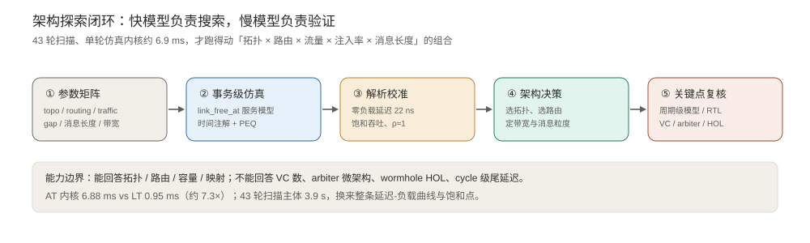

---

## 12. 能力边界

| 能回答（本模型可信） | 不能回答（需要周期级模型或 RTL） |
| --- | --- |
| 拓扑相对优劣、平均跳数、bisection 影响 | VC 数量与分配策略的精确收益 |
| 路由算法在目标 workload 下的相对表现 | arbiter 微架构（可分离分配、迭代次数） |
| 注入率-延迟曲线、饱和吞吐、设计余量 | 逐周期 HOL blocking、流水线气泡 |
| 消息长度 / 链路带宽的一阶影响 | cycle 级尾延迟、时钟门控 |
| 热点定位、最忙链路、任务映射趋势 | 精确 power / area / 布线长度 |
| 趋势、拐点、方案排序 | 绝对值精度、与 RTL 逐 cycle 对齐 |

**混合策略才是对的**：用事务级模型在上百个设计点里搜索，把候选缩到三五个；再对这几个点跑周期级模型（乃至 RTL / BookSim2）验证关键微观效应。快模型负责搜索，慢模型负责验证。

**另外两个必须说清的近似**：

1. 中间 router 的缓冲无硬上限，只有 NI 的 credit 窗口做反压。饱和点由链路服务率决定，因此模型在极重负载下对排队延迟偏乐观。
2. torus / ring 上用维度序路由没有做 VC 划分，模型不检查协议级死锁。架构探索阶段这是可接受的，落地前必须做形式化验证或周期级复核。

配套代码里还保留了 `code/tlm_feature_tour.cpp`（`make run-tour`），把 `peq_with_get` / `cancel_all`、`deep_copy_from`、多 passthrough initiator、大小端助手、DMI 与 analysis port 逐一演示，方便对照 TLM 接口本身。

---

## 13. 踩坑清单（都是这次实跑真踩到的）

| 坑 | 现象 | 解法 |
| --- | --- | --- |
| **PEQ 回调里的悬空迭代器** | `oblivious+hotspot` 30 次里崩 20 次，gdb 定位到 `std::vector::operator[](18446744073691660014)` | `nb_transport_bw` 会同步触发上游 `END_RESP`，重入本 router 并 `erase` 掉 `rx_ctx` 条目。必须先把 `bind` / `port` 取到局部变量再调用 |
| SystemC C++ 标准 ABI | `undefined reference to sc_api_version_2_3_4_cxx201402L` | 库与应用必须用同一标准编译；库用 `-DCMAKE_CXX_STANDARD=14`，应用 `-std=c++14` |
| MSYS make 重置 TMP | `Cannot create temporary file in C:\WINDOWS\: Permission denied` | Makefile 里 `export TMP/TEMP/TMPDIR` 到可写目录 |
| 链路利用率 > 1 | 热点流量算出 3.53 | 分母改用「该端口首次服务开始 → 末次服务结束」的活跃窗口，而不是全局观测窗口 |
| `multi_passthrough_target_socket` 零绑定 | torus/ring 报 `complete binding failed: port not bound` | 所有端口都有邻居时 `NullSink` 一个绑定都没有；用一个永不出事务的 `DummyInit` 兜底 |
| LT temporal decoupling | 延迟统计虚高 | `inject_time = sc_time_stamp() + qk.get_local_time()` |
| LT 握手字段读取时机 | `release()` 之后 payload 回池，`rv_ext` 已被清空 | 必须在 `release()` 之前读 `valid` / `ready` |
| `tlm_IGNORE_COMMAND` 拼错 | 编译报 `did you mean TLM_IGNORE_COMMAND` | 常量名是 `tlm::TLM_IGNORE_COMMAND` |
| `tlm_analysis_fifo` | SystemC 2.3.4 + C++14 名字查找失败 | 改用自定义 `tlm_analysis_port` + `tlm_analysis_if` |
| 大小端助手 | 模板参数推导失败 | 显式写 `tlm_to_hostendian_generic<unsigned int>` |
| `tlm_mm` 缺失 | `set_auto_extension` 触发 `m_mm != 0` 断言 | 演示用 payload 也先 `set_mm(&mm)` |
| DMI | 想给 router 造一个直访指针 | 有状态互连正确做法是拒绝，不要硬造 |

---

## 14. 交付文件

| 文件 | 内容 |
| --- | --- |
| `SystemC-TLM-Router建模.md` | 本文（Markdown 源文件） |
| `SystemC-TLM-Router建模.html` | 网页阅读版，表格 / 代码 / 配图排版后可直接用浏览器打开 |
| `assets/router-arch-spec.png` | 真实论文 Fig.1 架构图（从原 PDF 裁出） |
| `assets/tlm-basics.svg` | TLM 建模基本思路：事务、socket、时间注解、AT / LT |
| `assets/router-basics.svg` | Router 基本原理：端口、四级流水、credit 流控 |
| `assets/protocol-credit-vs-rv.svg` | credit vs ready/valid：两套协议、两种探索粒度 |
| `assets/txn-abstraction.svg` | 抽象层级决策：丢什么、留什么 |
| `assets/link-server-model.svg` | 链路单服务器模型与排队时间线 |
| `assets/dse-latency-throughput.svg` | 注入率扫描：AT/LT 延迟与吞吐、饱和点 |
| `assets/dse-topology.svg` | mesh / torus / ring 对比 |
| `assets/dse-routing-traffic.svg` | 路由 × 流量模式对比 |
| `assets/dse-msg-bw.svg` | 消息长度 / 链路带宽敏感性 |
| `assets/arch-exploration-loop.svg` | 架构探索闭环与能力边界 |
| `code/noc_txn_common.h` | 公共类型：`txn_ext` / `rv_ext` / `HopCtx`、扩展相位、memory manager、拓扑/路由/流量、配置 |
| `code/router_txn.h` | **AT router**：credit 流控、链路服务模型、四相、PEQ、时间注解、DMI/debug、统计 |
| `code/router_txn_lt.h` | **LT router**：ready/valid 握手 + `b_transport` 固定延迟累加、带宽账统计 |
| `code/noc_txn_top.cpp` | 统一顶层：三种拓扑、三种路由、四种流量、两套注入器、DMI/debug、可解析 CSV 输出 |
| `code/tlm_feature_tour.cpp` | TLM 接口巡礼：`peq_with_get`/`cancel_all`、`deep_copy_from`、多 passthrough initiator、analysis port、大小端、DMI、global quantum |
| `code/Makefile` | 编译 / 运行 / 扫描 |
| `tools/sweep.py` | 43 轮参数扫描驱动，输出 `data/dse_results.csv` 与 `data/dse_meta.json` |
| `tools/make_figs_txn.py` | 由 CSV 与元数据生成全部实测配图 |
| `tools/refresh_article.py` | 由 CSV 与元数据同步文章表格与正文数字，并做一致性自检 |
| `tools/md2html.py` | 生成网页阅读版 |

验证记录：SystemC 2.3.4 + GCC（MinGW-ucrt64）+ `-std=c++14`，`noc_txn_demo` / `tour` 全部编译通过；43 轮扫描全部成功，480 条消息每轮全部到达、边界丢包 0；AT credit 守恒（issued = returned）、LT 握手 `stalls = 0`；崩溃修复后同一配置压测 30 次 0 失败。

### 14.1 代码仓库与复现

| 项 | 值 |
| --- | --- |
| 仓库 | [github.com/andyzhenghome/systemc-tlm-router-dse](https://github.com/andyzhenghome/systemc-tlm-router-dse) |
| 分支 | `main`（公开） |
| 内容 | 本文 Markdown / HTML、全部源码与 Makefile、10 张 SVG 配图与论文架构图、43 轮扫描的 CSV 与计时元数据 |

依赖 SystemC 2.3.4（**库与示例必须用同一 C++ 标准编译**，本文为 C++14）、g++ 与 Python 3（仅标准库）。编译产物和本地 SystemC 构建目录不入库，所以 clone 后要显式传入安装前缀 `SYSTEMC`（指向含 `include/` 与 `lib/` 的目录）：

```bash
git clone https://github.com/andyzhenghome/systemc-tlm-router-dse.git
cd systemc-tlm-router-dse/code
make SYSTEMC=/path/to/systemc       # 编译 noc_txn_demo + tour
make run-at GAP=8                    # 轻载 AT（credit 流控）
make run-lt GAP=8                    # LT 对照（ready/valid）
./noc_txn_demo at 4 4 30 4 xy torus uniform 64 16
make run-tour                        # TLM 接口特性巡礼
make sweep                           # 43 轮扫描 + 出图 + 同步本文数字 + 生成 HTML
```

`make sweep` 会重刷 `data/dse_results.csv`、全部 SVG、本文的表格与正文数字以及网页版；同步脚本锚点驱动且带一致性自检，重复运行不会漂移。只想看数据而不编译，直接读仓库里的 `data/dse_results.csv` 即可拿到 43 轮原始结果。

---

## 15. 小结

架构探索模型的难点从来不是「能不能做细」，而是「敢不敢做粗、以及粗到什么程度还敢下结论」。

这一版给出的答案是：**实现细节可以丢，竞争不能丢**。用 `link_free_at[op]` 一个时间戳数组把竞争上移到链路级，用 `sc_time&` 时间注解把排队和串行化时间传递下去，TLM 的四相握手、PEQ、扩展、DMI、analysis port 一个没少。

在此之上，两套流控协议划出了两种探索粒度：**LT 用 ready/valid，回答连通性和带宽够不够；AT 用 credit，回答延迟和拥塞怎么样**。同一份 spec、同一套参数、同一个顶层，换一个模式就能从「路通不通」切到「会不会堵」——这才是统一 router 模型对架构探索真正的价值。

然后先用解析式校准零负载延迟和饱和吞吐，再去扫参数——**没有校准的架构探索，只是把偏见画成了图表**。

最后别忘了一句：模型能回答的是趋势和拐点，不是绝对精度。把候选从一百个缩到三个之后，该回到周期级模型甚至 RTL 去验证的，一步都不能省。

---

## 参考

1. R. Mullins, A. West, S. Moore, *The Design and Implementation of a Low-Latency On-Chip Network*, ASPDAC 2006. <https://www.cl.cam.ac.uk/~swm11/research/papers/ASPDAC2006.pdf> —— 本文 Fig.1 架构图来源。
2. N. Jiang et al., *A Detailed and Flexible Cycle-Accurate Network-on-Chip Simulator* (BookSim2), ISPASS 2013. <https://icn.kaist.ac.kr/~jjk12/papers/2013ISPASS.pdf> —— 四级流水、evaluate/update 两阶段协议。
3. *BookSim 2.0 User's Guide*, §4.5.1 input-queued router / §4.6 allocators. <https://usermanual.wiki/Pdf/manual.1352772804.pdf>
4. BookSim2 `IQRouter` 源码梳理。 <https://deepwiki.com/booksim/booksim2/5-router-architecture>
5. Accellera, *IEEE Std 1666-2011 SystemC / TLM-2.0 LRM*；OSCI *TLM-2.0 Presentation*（base protocol 规则、扩展相位、PEQ、DMI）。 <https://www.cl.cam.ac.uk/research/srg/han/ACS-P35/documents/TLM_2_0_presentation.pdf>
6. Doulos, *What's New in TLM-2.0.1*（PEQ `cancel_all()`、`deep_copy_from` 等）。 <https://www.doulos.com/knowhow/systemc/tlm-20/whats-new-in-tlm-201/>
7. W. J. Dally, B. Towles, *Principles and Practices of Interconnection Networks* —— oblivious 路由在对抗性置换流量上的经典结论。
8. Accellera SystemC 2.3.4 源码（`tlm_phase.h` 的 phase registry、`tlm_gp.h` 的引用计数与扩展机制）。
